# AFCON 2025 — Data Warehouse & Power BI

Projet académique de Business Intelligence réalisé dans le cadre du Master SIDI, à la Faculté des Sciences et Techniques d’Errachidia, Université Moulay Ismail. Le projet associe des données footballistiques CSV, un entrepôt MySQL et un rapport Power BI de sept pages.

**Auteurs : Akram Boukotos, Soufian Haskouk et Hassane Oulberj.**


## Résultats disponibles

Les exports SQL fournis contiennent **52 matchs, 24 équipes, 555 joueurs, 8 stades et 121 buts**. Ces chiffres décrivent les fichiers de ce projet ; ils ne constituent pas une vérification indépendante des résultats sportifs.

- Navigation entre accueil, matchs, équipes, stades, profils et comparaison de joueurs.
- Analyse des buts, tirs, cartons, affluences et statistiques des joueurs.
- Quatre dimensions et trois tables de faits, avec huit relations de clés étrangères.
- Rapport académique et captures du dashboard.
- Scripts SQL d’installation et contrôles de qualité reproductibles.

**Périmètre de reproduction :** les exports MySQL et le PBIX sont fournis. Le rapport décrit une intégration Talend, mais les fichiers sources des jobs Talend ne figurent pas dans le dossier reçu. Le pipeline ETL complet ne peut donc pas être rejoué à partir de ce dépôt seul.

## Aperçu du dashboard

Captures extraites sans modification des pages 21 à 27 du rapport fourni. Elles montrent l’état documenté du projet, pas une nouvelle exécution vérifiée du PBIX.

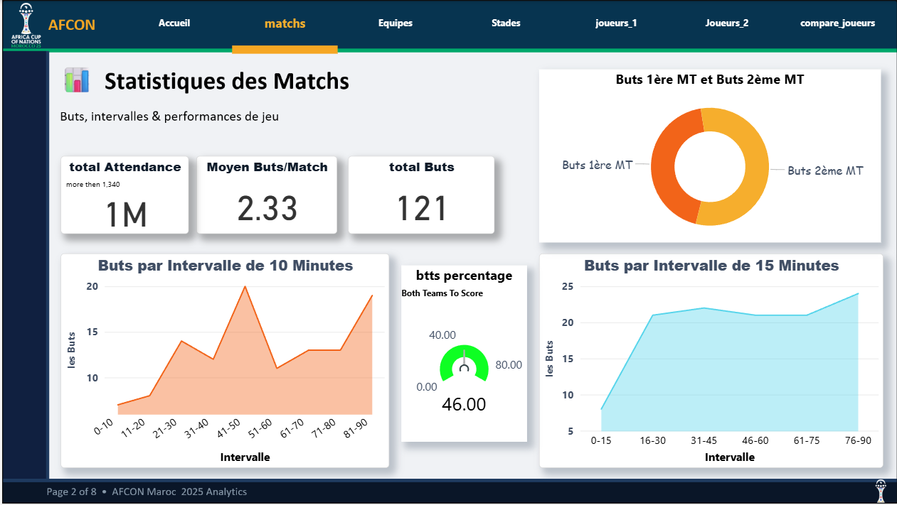

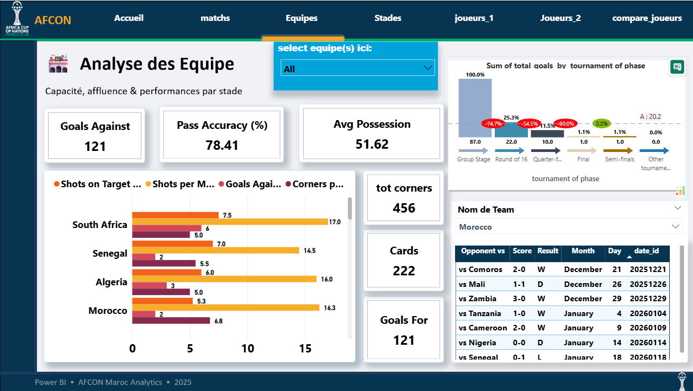

<details>
<summary>Afficher les autres pages</summary>

### Stades
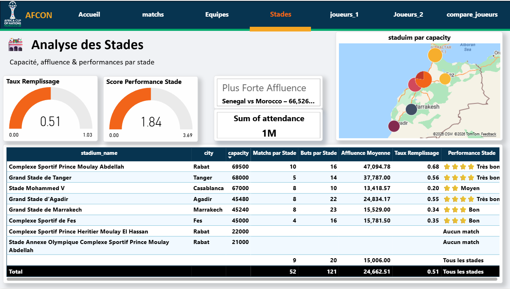

### Profils des joueurs
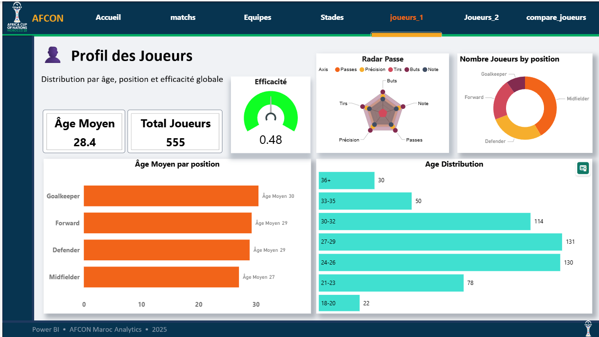

### Statistiques des joueurs
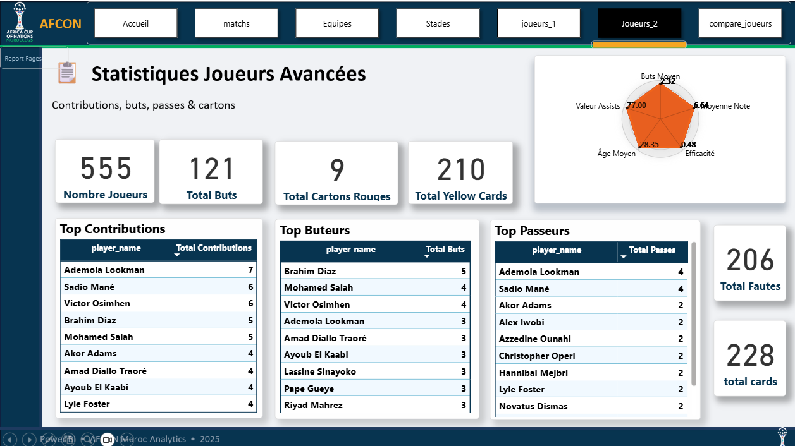

### Comparaison des joueurs
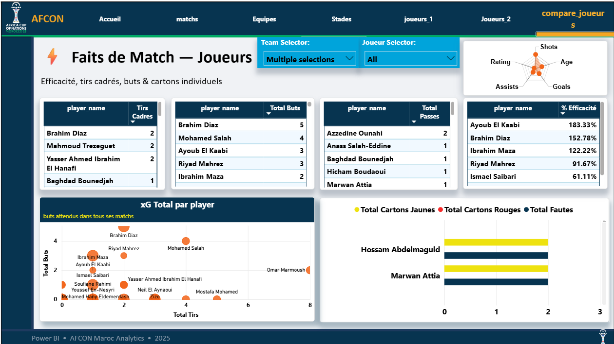

</details>

## Aperçu de l’intégration Talend

Les six captures ci-dessous illustrent les jobs. Elles ne contiennent pas les sources exécutables Talend ; certains composants affichent des avertissements ou erreurs de configuration dans l’état capturé.

<details>
<summary>Afficher les six jobs ETL</summary>

### Dimension Date
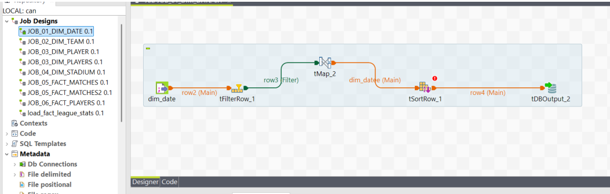

### Dimension Équipe
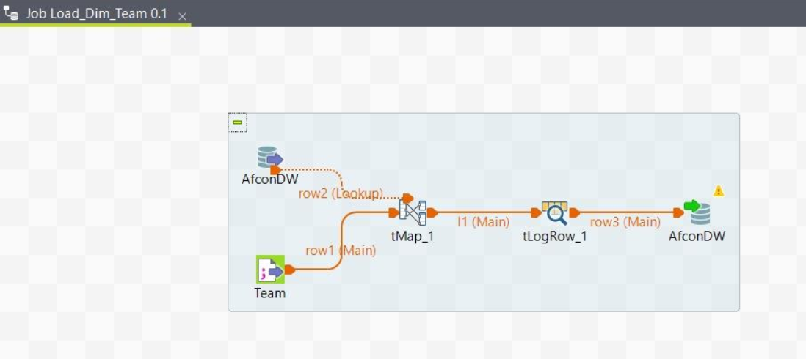

### Dimension Joueur
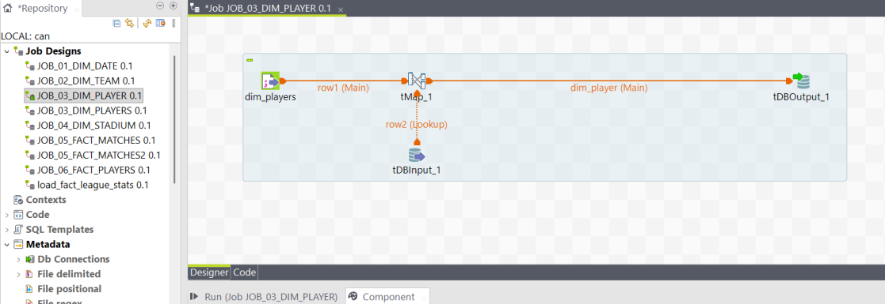

### Dimension Stade
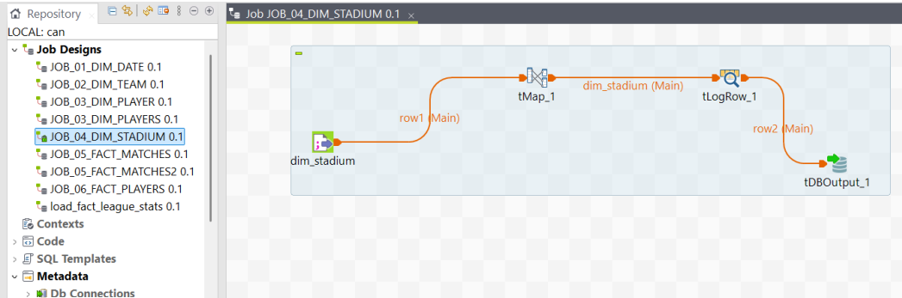

### Faits Matchs
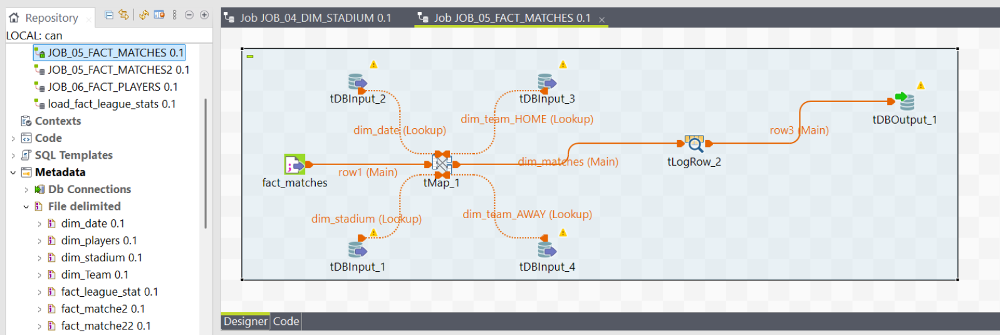

### Faits Joueurs
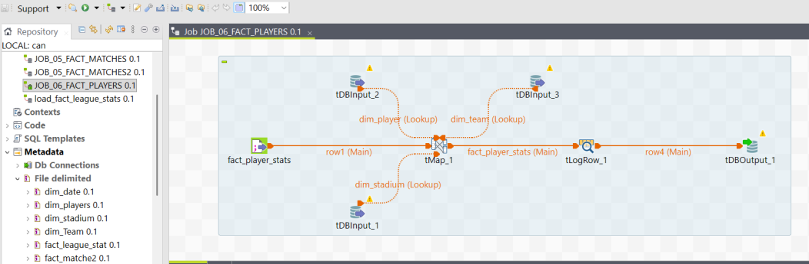

</details>

## Organisation

```text
data/raw/               Quatre CSV d’origine, non modifiés
database/01-schema.sql  Création d’une nouvelle base de démonstration
database/02-data.sql    Données extraites des dumps fournis
database/03-checks.sql  Requêtes de contrôle MySQL
database/tables/        Sept dumps SQL originaux
powerbi/afcon-2025.pbix Rapport Power BI original renommé
docs/                   Rapport, architecture, dictionnaire et audit
screenshots/            Sept captures extraites du rapport
ETL_Talend/              Six captures des jobs Talend
scripts/validate_data.py Contrôles hors ligne, sans dépendance externe
```

## Consulter le projet

1. Parcourir les captures ci-dessus ou [le rapport PDF](docs/rapport-afcon-2025.pdf).
2. Télécharger [le fichier Power BI](powerbi/afcon-2025.pbix), puis l’ouvrir dans Power BI Desktop sous Windows. GitHub ne permet pas d’interagir directement avec un fichier PBIX.
3. Pour actualiser les données, suivre [le guide d’installation](docs/INSTALLATION.md). Les paramètres de connexion locaux doivent être adaptés.

## Installer la base de démonstration

Dans MySQL Workbench, sur un serveur **MySQL 8.0 ou compatible avec la collation `utf8mb4_0900_ai_ci`** :

1. Ouvrir et exécuter `database/01-schema.sql` **en arrêtant à la première erreur**. Il crée `afcon_2025_demo` et ses sept tables. Si cette base existe déjà, ne pas continuer : utiliser un nouveau nom dans les deux scripts ou un serveur de test.
2. Exécuter `database/02-data.sql` une seule fois dans cette base neuve.
3. Exécuter `database/03-checks.sql` pour examiner les effectifs et anomalies.

Ces scripts ne suppriment aucune base existante. Les dumps de `database/tables/` contiennent, eux, des `DROP TABLE` d’origine : ils sont conservés pour traçabilité et ne sont pas le chemin d’installation recommandé.

## Contrôles hors ligne

Python 3.10+ suffit, sans installation de bibliothèque :

```powershell
python scripts/validate_data.py
```

Le script lit les CSV et les valeurs des dumps, réalise des contrôles dans une base SQLite en mémoire et écrit `docs/data-quality.json`. Il ne se connecte pas à MySQL et ne valide pas l’exécution du DDL MySQL.

## Qualité des données et limites

| Point vérifié | Résultat |
| --- | --- |
| CSV `teams` | Copie exacte du CSV `matches`, pas un jeu de statistiques d’équipes |
| CSV joueurs | 556 lignes, dont une sans nom ; entrepôt de 555 joueurs |
| Matchs sans stade associé | 9 sur 52 |
| Statistiques de joueurs sans équipe associée | 73 sur 555 |
| Âges hors de la plage de contrôle 15–45 ans | 16 ; à vérifier, pas corrigés automatiquement |
| Dates de `fact_player_stats` | Une seule date distincte pour toutes les lignes |
| Clés primaires dupliquées / références non nulles orphelines | Aucune détectée dans les dumps |

Les statistiques joueurs sont agrégées et ne doivent pas être présentées comme un historique individuel match par match. Les relations nulles peuvent affecter les filtres et les agrégations du dashboard. Voir [l’audit détaillé](docs/VALIDATION.md).

## Provenance et contributions

Le rapport cite notamment FootyStats et la CAF. Les CSV, SQL, PBIX et PDF sont conservés sans changement de contenu. Les règles de redistribution et les licences des sources ne sont pas précisées dans les fichiers reçus ; aucune licence globale de réutilisation n’a été ajoutée. Les logos et visuels tiers restent attribuables à leurs auteurs respectifs.

La présentation « Performance et Coût — Data Warehouses Cloud » relève d’un sujet distinct. Elle a été conservée dans les archives locales, hors de ce dépôt.

Les scripts d’audit, l’installation SQL consolidée, la documentation de publication et l’extraction des captures ont été ajoutés lors de l’organisation du dépôt. Ils ne remplacent pas les jobs Talend du projet original.
