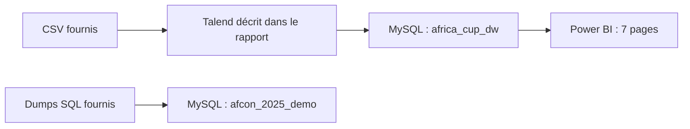
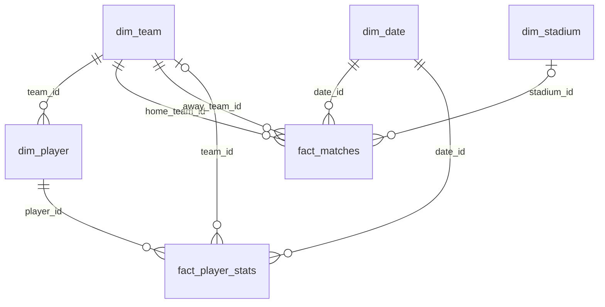

# Architecture observée

Les sources des jobs ETL ne sont pas incluses. Le diagramme décrit le projet documenté et le chemin de restauration ajouté, pas une exécution ETL nouvellement vérifiée.

`fact_league_stats` est une table d’agrégats sans clé étrangère déclarée. Les deux relations de `fact_matches` vers `dim_team` représentent les rôles domicile et extérieur ; leur configuration dans Power BI doit être vérifiée pour éviter des filtres ambigus.

## Grain des tables

| Table | Grain observé | Lignes |
| --- | --- | ---: |
| dim_date | Une date de compétition | 19 |
| dim_team | Une équipe nationale | 24 |
| dim_stadium | Un stade | 8 |
| dim_player | Un joueur | 555 |
| fact_matches | Un match | 52 |
| fact_player_stats | Une ligne agrégée par joueur, tous rattachés à la même date | 555 |
| fact_league_stats | Une compétition/saison | 1 |

La présence d’une `date_id` dans `fact_player_stats` ne suffit pas à transformer ces agrégats en statistiques par match. Aucun identifiant de match n’est présent dans cette table.
